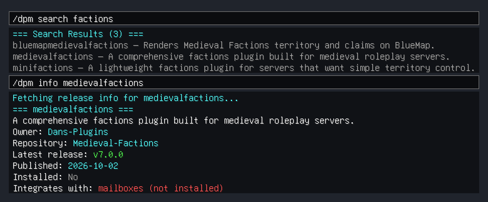

# Dan's Plugin Manager

*Real in-game output from Dan's Plugin Manager 0.6.0 on a local throwaway Paper 1.21.11 test server: the commands were typed by a scripted bot client, and the chat it received is drawn as Minecraft-style chat (typed commands appear in the input bars; grey lines say what happened between commands).*

## Description
This Minecraft plugin lets server operators download DPC plugins in-game or from the server console.

## Download
- [SpigotMC](https://www.spigotmc.org/resources/dans-plugin-manager-early-access.100279/)
- [GitHub releases](https://github.com/Dans-Plugins/Dans-Plugin-Manager/releases)

## Usage
- [User Guide](USER_GUIDE.md)
- [Commands](COMMANDS.md)
- [Release channels](USER_GUIDE.md#release-channels) — opt a plugin into main-branch builds with `/dpm get <plugin-name> --experimental`

## Support
[Discord](https://discord.gg/xXtuAQ2) — [Bug reports](https://github.com/Dans-Plugins/Dans-Plugin-Manager/issues?q=is%3Aissue+is%3Aopen+label%3Abug)

## Usage reporting

Usage reporting is on by default: when the plugin is enabled, and each time a player uses `/dpm`, it
sends its name, its version and the command's name (`startup` and `command` events) to
https://trace.danielstephenson.dev so it is known which plugins are actually in use. Nothing about
players, worlds, IPs, or anything typed after a command is sent. The plugin says on
every startup whether reporting is on. Each event also carries a random server ID (the `server-id` line in `plugins/trace/config.yml`) so
servers can be counted rather than events. It identifies no person, account or IP address; delete
the line to get a new one.

To turn it off:

- for this plugin: `usage-reporting.enabled: false` in `plugins/DansPluginManager/config.yml`
- for every plugin on the server that reports this way: `enabled: false` in `plugins/trace/config.yml`
  (created the first time such a plugin starts)
- for the whole process: the environment variable `TRACE_USAGE_REPORTING=off` or `DO_NOT_TRACK=1`

Details: https://danielstephenson.dev/usage-reporting

## Contributing
See [CONTRIBUTING.md](CONTRIBUTING.md).

## Authors
Name | Contributions
------------ | -------------
Daniel Stephenson | Creator
Mr-Deej | Minor cleanup and fixes

## License
MIT
